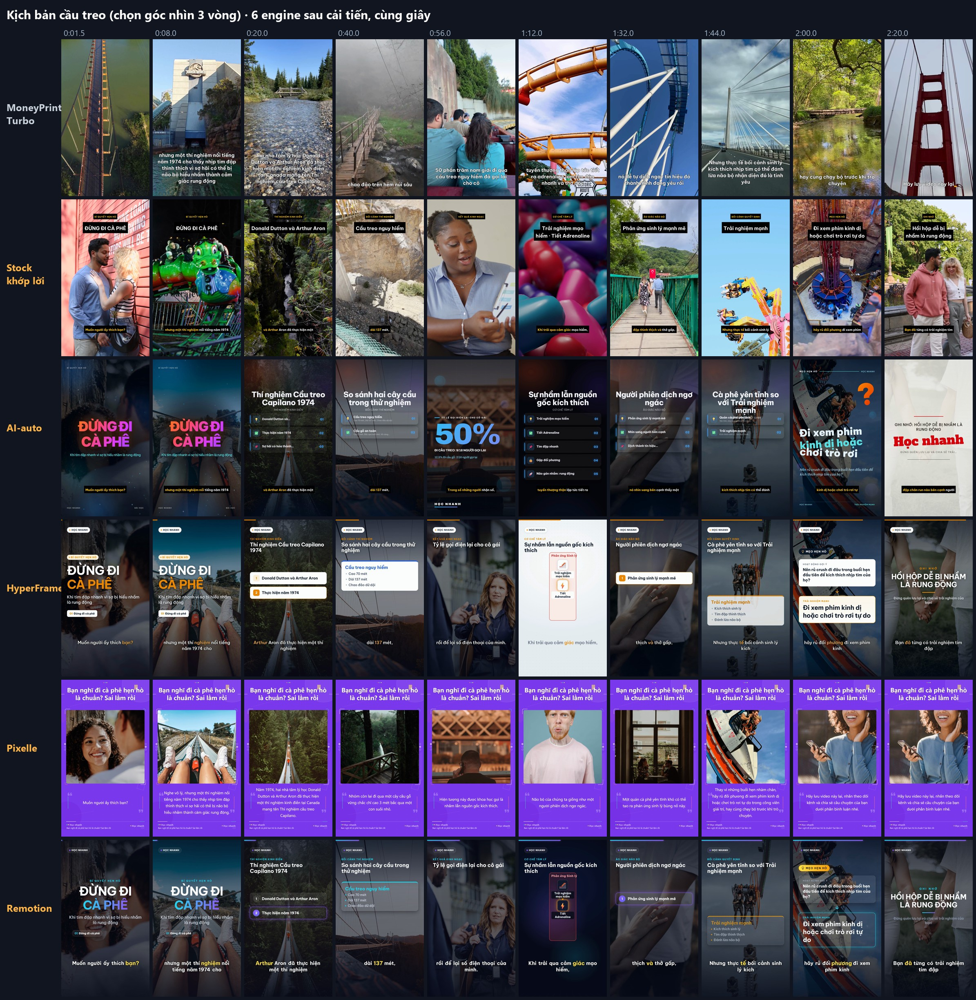

# Video Factory

**Một kịch bản → 6 engine dựng 6 phiên bản video dọc 9:16 → xem song song trên web → chọn 1 bản để đăng TikTok / YouTube Shorts.**

Chạy trên Windows, giọng đọc tiếng Việt miễn phí (Edge TTS), phụ đề karaoke khớp từng chữ. Ảnh minh hoạ đổi theo từng câu,
lấy từ một trong ba nguồn: Pexels (ảnh chụp, miễn phí), **tự vẽ bằng card đồ hoạ của máy** (ComfyUI + SDXL-Lightning),
hoặc ảnh thật trên Wikimedia Commons cho video về người và sự kiện có thật. Gemini (miễn phí) viết nháp kịch bản từ một chủ đề.



| Engine | Phong cách | Thời gian render (video 1–2 phút, đo trên máy dựng hệ thống) |
|---|---|---|
| [MoneyPrinterTurbo](https://github.com/harry0703/MoneyPrinterTurbo) | Clip stock (hoặc ảnh tự vẽ) + phụ đề; tuỳ chọn **bản podcast** giọng ElevenLabs | ~8 phút (3–27) |
| Stock khớp lời (viết riêng) | Clip Pexels đổi theo **từng câu**, chữ và số hiện đúng lúc đọc | ~2,5 phút |
| [AI-auto-generate-video](https://github.com/huytranvan2010/AI-auto-generate-video) | Template poster động trên ảnh đổi theo câu | ~3 phút |
| [HyperFrames](https://www.npmjs.com/package/hyperframes) | Học thuật nền sáng: sơ đồ dựng dần, phụ đề karaoke | ~4 phút |
| [Pixelle-Video](https://github.com/ATH-MaaS/Pixelle-Video) | Mỗi câu một khung: ảnh + chữ | ~2 phút |
| [Remotion](https://www.remotion.dev) | Nền tối, phụ đề kiểu TikTok | ~7 phút |

Hệ thống **không tự đăng** video: bạn xem, chọn bản ưng ý, rồi tự tải lên kênh.

## Mục lục

1. [Cần chuẩn bị gì](#1-cần-chuẩn-bị-gì)
2. [Đăng ký tài khoản và lấy key](#2-đăng-ký-tài-khoản-và-lấy-key)
3. [Cài phần mềm nền](#3-cài-phần-mềm-nền)
4. [Tải mã và cài đặt](#4-tải-mã-và-cài-đặt)
5. [Điền key](#5-điền-key)
6. [Chạy web](#6-chạy-web)
7. [Làm video — cách bình thường](#7-làm-video--cách-bình-thường)
8. [Tự tạo ảnh bằng AI trên máy](#8-tự-tạo-ảnh-bằng-ai-trên-máy)
9. [Ảnh thật cho người và sự kiện có thật](#9-ảnh-thật-cho-người-và-sự-kiện-có-thật)
10. [Bản podcast giọng ElevenLabs](#10-bản-podcast-giọng-elevenlabs)
11. [Đăng video](#11-đăng-video)
12. [Viết kịch bản bằng tay (định dạng JSON)](#12-viết-kịch-bản-bằng-tay-định-dạng-json)
13. [Mọi thiết lập trong .env](#13-mọi-thiết-lập-trong-env)
14. [Cấu trúc thư mục](#14-cấu-trúc-thư-mục)
15. [Dùng bằng dòng lệnh](#15-dùng-bằng-dòng-lệnh)
16. [Xử lý sự cố](#16-xử-lý-sự-cố)
17. [Giấy phép và bản quyền](#17-giấy-phép-và-bản-quyền)

---

## 1. Cần chuẩn bị gì

| | Tối thiểu | Máy đã dùng để dựng hệ thống |
|---|---|---|
| Hệ điều hành | Windows 10 hoặc 11, 64-bit | Windows 11 |
| RAM | 8 GB (đặt `FACTORY_PARALLEL=1`) | 16 GB trở lên, CPU 32 luồng |
| Ổ đĩa trống | ~10 GB (cài thường) — thêm ~25 GB nếu tự vẽ ảnh | |
| Card đồ hoạ | Không cần — **trừ khi tự vẽ ảnh**: NVIDIA RTX, ≥ 8 GB VRAM, driver ≥ 580 | RTX 4060 Laptop 8 GB: ~3 giây/ảnh |
| Mạng | Ổn định (tải ~3 GB khi cài, thêm ~9 GB nếu tự vẽ ảnh) | |

Thời gian cài: 15–30 phút cho phần thường, thêm 30–90 phút (tuỳ mạng) cho công cụ tự vẽ ảnh.

## 2. Đăng ký tài khoản và lấy key

| Dịch vụ | Dùng để | Bắt buộc? | Chi phí |
|---|---|---|---|
| Google AI Studio (Gemini API) | Viết nháp kịch bản, đặt từ khoá / mô tả ảnh cho từng câu, soát ảnh | **Có** | Miễn phí (có hạn mức) |
| Pexels API | Ảnh và clip stock | **Có** | Miễn phí |
| GitHub | Tải mã về bằng `git clone` | Nên có | Miễn phí |
| ElevenLabs | Giọng podcast (chỉ bản MoneyPrinterTurbo) | Không | Free (làm tay) / trả phí để tự động |
| TikTok, YouTube | Kênh để đăng video | Tuỳ bạn | Miễn phí |

Không cần tài khoản: giọng đọc Edge TTS, Hugging Face (tải model vẽ ảnh), Wikimedia Commons, ComfyUI.

### Gemini API key (bắt buộc)

1. Mở <https://aistudio.google.com/apikey>, đăng nhập bằng tài khoản Google.
2. Bấm **Create API key** (được hỏi thì cho tạo project mới). Chép chuỗi key — thường bắt đầu bằng `AIza`.
3. Để dành, bước 5 sẽ dán vào `.env`: `GEMINI_API_KEY=<key>`.

Gói miễn phí không cần thẻ, nhưng giới hạn số lần gọi theo phút và theo ngày, giờ cao điểm hay báo quá tải (503) — hệ
thống tự chờ và tự đổi sang model dự phòng, một bản nháp thường mất 1–3 phút. Gói miễn phí **không vẽ ảnh** được (nguồn
ảnh `gemini` cần bật thanh toán; nguồn `comfyui` thì miễn phí). Theo điều khoản của Google, dữ liệu gửi qua gói miễn phí
có thể được dùng để cải thiện sản phẩm — đừng đưa thông tin nhạy cảm vào kịch bản.

### Pexels API key (bắt buộc)

1. Tạo tài khoản ở <https://www.pexels.com/join> (miễn phí).
2. Mở <https://www.pexels.com/api/>, bấm **Your API Key** (lần đầu phải điền mục đích dùng, ví dụ
   "Personal tool that makes short educational videos"), chép key.
3. Để dành cho `.env`: `PEXELS_API_KEY=<key>`.

Hạn mức mặc định: 200 lượt gọi mỗi giờ, 20.000 lượt mỗi tháng — đủ cho vài chục video mỗi ngày. Ảnh và clip Pexels
dùng miễn phí, không bắt buộc ghi nguồn.

### ElevenLabs (tuỳ chọn — chỉ cho bản podcast)

1. Tạo tài khoản ở <https://elevenlabs.io>.
2. **Gói Free**: không cần key. Trên web Video Factory bấm *Làm giọng trên ElevenLabs* — hệ thống chép sẵn lời, mở trang
   Text to Speech; bạn tự chọn giọng, dán, *Generate*, *Download*; file mp3 trong thư mục Downloads được nhận tự động.
3. **Gói trả phí** (Starter trở lên) mới gọi được giọng thư viện qua API (gói Free bị từ chối, lỗi 402). Muốn tự động hoàn
   toàn: *Developers → API Keys → Create*, cấp quyền *Text to Speech* và *Voices: Write*, chép key vào `.env`:
   `ELEVENLABS_API_KEY=<key>`.

Đọc điều khoản của ElevenLabs trước khi đăng video kiếm tiền: gói Free không có quyền dùng thương mại và yêu cầu ghi nguồn.

## 3. Cài phần mềm nền

Mở **PowerShell** (bấm Start, gõ `powershell`) rồi chạy lần lượt — `winget` có sẵn trên Windows 10/11:

```powershell
winget install --id Git.Git -e
winget install --id astral-sh.uv -e
winget install --id OpenJS.NodeJS.LTS -e
winget install --id Gyan.FFmpeg -e
winget install --id Google.Chrome -e
winget install --id 7zip.7zip -e
```

| Phần mềm | Để làm gì |
|---|---|
| Git | Tải mã và 3 repo engine |
| uv | Cài Python và thư viện Python (tự tải đúng phiên bản Python, không cần cài Python riêng) |
| Node.js LTS (≥ 22) | HyperFrames, Remotion, AI-auto-generate-video |
| FFmpeg | Ghép video, gắn phụ đề, chuẩn hoá âm lượng |
| Google Chrome | HyperFrames, Remotion, AI-auto chụp khung hình bằng Chrome |
| 7-Zip | Giải nén ComfyUI (chỉ cần nếu tự vẽ ảnh) |

Cài xong **đóng PowerShell và mở cửa sổ mới** (để Windows nhận đường dẫn mới), kiểm tra:

```powershell
git --version; uv --version; node --version; ffmpeg -version
```

## 4. Tải mã và cài đặt

Chọn thư mục **không có dấu cách, không có chữ có dấu, không nằm trong OneDrive** — ví dụ `C:\video-factory`:

```powershell
cd C:\
git clone https://github.com/<tài-khoản>/video-factory.git
cd video-factory
.\cai-dat.cmd
```

(Hoặc mở thư mục bằng File Explorer và bấm đúp `cai-dat.cmd`.) Nếu tải bằng nút *Download ZIP* trên GitHub: trước khi giải
nén, chuột phải file zip → *Properties* → tick *Unblock* → *OK*, không thì Windows có thể chặn các file `.cmd` / `.ps1`.

`cai-dat.cmd` làm lần lượt (chạy lại bao nhiêu lần cũng được — phần đã xong sẽ bỏ qua):

1. kiểm tra Git, uv, Node.js, FFmpeg, Chrome — thiếu thì in lệnh `winget` cần chạy rồi dừng
2. tạo file `.env` từ `.env.example` và mở bằng Notepad để bạn điền key
3. cài thư viện Python của web (`uv sync`) và thư viện Node của HyperFrames, Remotion, ELK (`npm ci`)
4. tải 3 repo engine **đúng commit đã chạy thử** vào `engines\` rồi cài thư viện của từng repo:
   MoneyPrinterTurbo (`uv sync`), AI-auto-generate-video (`npm ci`), Pixelle-Video (`uv sync` + Chromium cho Playwright)
5. chép key Gemini / Pexels từ `.env` sang `config.toml` của MoneyPrinterTurbo
6. in tình trạng: key nào đã có, engine nào sẵn sàng

Cuối cùng thấy `[ok]` ở cả 6 engine là xong. Chỉ xem lại tình trạng: `.\cai-dat.cmd -KiemTra`.

## 5. Điền key

Mở `.env` (Notepad, nằm ở thư mục gốc) và dán key lấy ở bước 2, **không có dấu cách, không có ngoặc kép**:

```ini
GEMINI_API_KEY=AIza...
PEXELS_API_KEY=...
```

Lưu file rồi **chạy lại `cai-dat.cmd`** để key được chép sang MoneyPrinterTurbo (lần này chỉ mất vài giây).
`.env` chỉ nằm trên máy bạn và đã có trong `.gitignore` — không bao giờ bị đưa lên GitHub. Các thiết lập khác: [mục 13](#13-mọi-thiết-lập-trong-env).

## 6. Chạy web

Bấm đúp **`chay-web.cmd`**. Một cửa sổ đen hiện ra (server), sau 5 giây trình duyệt tự mở <http://127.0.0.1:8600>.
**Đóng cửa sổ đen là tắt web.** Báo cổng 8600 đang được dùng nghĩa là web đã chạy sẵn ở cửa sổ khác — cứ mở địa chỉ trên.

Các ô engine ở đầu trang: chấm xanh lá là sẵn sàng, chấm vàng là chưa (rê chuột vào để xem lý do).

## 7. Làm video — cách bình thường

Cách bình thường dùng **ảnh và clip Pexels** — không cần card đồ hoạ.

**Bước 1 — có kịch bản**, chọn một trong hai tab:

- **Từ chủ đề**: gõ chủ đề (ví dụ *"Vì sao ta hay nhớ người cũ?"*), chọn **Độ dài** (~1 / 2 / 3 phút) và **Kiểu mở đầu**
  (tò mò, phá niềm tin, danh sách, rủi ro, câu hỏi thi — hoặc để Gemini chọn), ghi chú thêm nếu cần. Tuỳ chọn:
  - *Rà soát kiến thức* — Gemini kiểm lại dữ kiện (dùng Google Search nếu còn hạn mức);
  - *Kèm bản podcast* — viết thêm lời kiểu podcast tâm sự cho MoneyPrinterTurbo ([mục 10](#10-bản-podcast-giọng-elevenlabs));
  - *Chọn góc nhìn 3 vòng* — Gemini nghĩ 12 góc kể, giữ 3, viết 3 đoạn mở đầu rồi chấm cặp; góc thắng thành khung bài (thêm 3 lần gọi).

  Bấm **Nhờ Gemini viết nháp** (1–3 phút). Nháp hiện ra dạng JSON: **đọc lại kỹ** (Gemini có thể sai kiến thức), sửa nếu
  cần, bấm **Lưu thay đổi**. Nháp lưu ở `content/drafts/`.
- **Kịch bản có sẵn**: chọn một file trong `content/` → **Mở kịch bản**. Repo có sẵn vài kịch bản mẫu (tâm lý, kiến thức,
  thiên nhiên, AWS, sơ đồ).

**Bước 2 — tạo video**: tick các engine muốn dùng → **Tạo video**. Mỗi engine là một tác vụ nền (mặc định chạy 2 engine
cùng lúc); cột *Các lần tạo* hiện tiến độ. Nút **Log** xem nhật ký từng engine, **Chạy lại** khi một engine lỗi.

**Bước 3 — chọn bản để đăng**: xem các bản ngay trên trang, bấm **Chọn để đăng** ở bản ưng ý → file video và `caption.txt`
(tiêu đề, mô tả, hashtag, ghi nguồn ảnh nếu có) được chép vào `publish/<lần-tạo>/`. Xem [mục 11](#11-đăng-video).

Ảnh lấy từ Pexels nên đúng "loại cảnh" nhưng không đúng người / vật cụ thể: Pexels tốt với thứ quay được (cảnh vật, đồ
ăn, cảm xúc người), kém với khái niệm trừu tượng ("load balancer" ra… xe tải). Muốn ảnh khớp lời hơn: tự vẽ ([mục 8](#8-tự-tạo-ảnh-bằng-ai-trên-máy));
muốn đúng người thật: Wikimedia Commons ([mục 9](#9-ảnh-thật-cho-người-và-sự-kiện-có-thật)).

### Giọng VieNeu-TTS (tuỳ chọn, chạy trên máy)

Ngoài Edge TTS, bạn có thể chọn **VieNeu-TTS** cho cả 6 engine: video slide/sơ đồ và video ảnh/footage đều dùng được.
Factory gọi [speech API v3 Turbo của VieNeu](https://github.com/pnnbao97/VieNeu-TTS/blob/main/apps/openai_speech.py)
qua mạng cục bộ; không cài model VieNeu vào môi trường của factory. Server cục bộ không cần API key, trừ khi bạn
tự bật xác thực. Việc này không thay thế key Gemini/Pexels cho viết nháp và lấy stock.

1. Cài VieNeu trong **thư mục riêng** theo [hướng dẫn chính thức](https://github.com/pnnbao97/VieNeu-TTS).
   Ví dụ CPU (không cần GPU), chạy trong terminal riêng và giữ cửa sổ mở:

   ```powershell
   git clone https://github.com/pnnbao97/VieNeu-TTS.git
   cd VieNeu-TTS
   uv sync
   uv run python -m apps.openai_speech
   ```

   Server mặc định ở `http://127.0.0.1:8000`; lần đầu tải và nạp model cần thời gian. Muốn dùng GPU, làm theo
   hướng dẫn CUDA của VieNeu trước khi bật server.

2. Factory dùng **faster-whisper** để căn mốc từng chữ trên giọng VieNeu. Nếu đã cài MoneyPrinterTurbo bằng
   `cai-dat.cmd`, hệ thống dùng môi trường Whisper của engine đó. Nếu chỉ dùng engine slide và chưa cài
   MoneyPrinterTurbo, cài thêm vào môi trường factory (chạy ở thư mục Video Factory):

   ```powershell
   uv pip install --python .venv faster-whisper
   ```

   Lệnh `uv sync` sau này có thể gỡ thư viện cài bổ sung; khi đó cài lại lệnh trên. Hoặc đặt `ALIGN_PYTHON`
   trong `.env` tới interpreter của một môi trường riêng đã cài faster-whisper. Whisper tải model `small`
   khi dùng lần đầu, xử lý trên CPU; mốc các chữ không nhận diện được sẽ được nội suy từ chữ khớp gần nhất.

3. Trên web, mở kịch bản → **Giọng đọc video → VieNeu-TTS** → chọn tên giọng từ gợi ý (ví dụ `Mai Anh`).
   Để trống dùng `VIENEU_VOICE` trong `.env`, mặc định `Hải Đăng`. Bấm **Tải lại danh sách giọng** nếu vừa bật server.
   Bấm **Lưu thay đổi** để giữ lựa chọn trong kịch bản, rồi **Tạo video**.

Thiết lập `.env` tuỳ chọn: `VIENEU_URL=http://127.0.0.1:8000`, `VIENEU_VOICE=Hải Đăng`,
`VIENEU_API_KEY=<key server nếu đã bật Bearer auth>`. `VIENEU_URL` cũng nhận URL kết thúc bằng `/v1`.
Đổi server/giọng tạo cache audio riêng. Nếu server hoặc Whisper lỗi, job báo lỗi để bạn sửa và chạy lại.

Kịch bản JSON có thể thêm `"tts_provider": "vieneu", "vieneu_voice": "Mai Anh"`; trường `voice` vẫn giữ giọng Edge
để chuyển lại. Kịch bản cũ không có `tts_provider` tiếp tục dùng Edge. Với podcast MoneyPrinterTurbo,
file giọng tải lên được ưu tiên; nếu không có file, lựa chọn VieNeu được dùng thay ElevenLabs.

## 8. Tự tạo ảnh bằng AI trên máy

Ảnh được **vẽ ngay trên card đồ hoạ của bạn** bằng [ComfyUI](https://github.com/Comfy-Org/ComfyUI) (bản portable, không cần
cài Python) và model [SDXL-Lightning 4 bước](https://huggingface.co/ByteDance/SDXL-Lightning) của ByteDance. Miễn phí, không
giới hạn, không gửi gì lên mạng ngoài lời mô tả cho Gemini. Mỗi câu một ảnh khớp đúng nội dung câu đó (bản
MoneyPrinterTurbo: mỗi vế câu). Áp dụng cho MoneyPrinterTurbo, AI-auto, HyperFrames, Pixelle, Remotion; *Stock khớp lời*
luôn dùng clip Pexels.

### 8.1 Cài (một lần)

1. Kiểm tra driver NVIDIA: mở PowerShell, gõ `nvidia-smi` — số *Driver Version* phải **≥ 580** (bản ComfyUI này dùng
   CUDA 13). Thấp hơn thì tải driver mới ở <https://www.nvidia.com/Download/index.aspx> (Game Ready hoặc Studio đúng
   card), cài xong khởi động lại máy.
2. Bấm đúp **`cai-comfyui.cmd`**. Script kiểm tra card / ổ đĩa / 7-Zip, tải 2 file (~9 GB) vào `engines\_downloads\`,
   **so mã SHA-256** với bản đã thử, giải nén ComfyUI vào `engines\ComfyUI_windows_portable\` và đặt model vào
   `ComfyUI\models\checkpoints\`. Rớt mạng thì chạy lại — file đang tải dở được tải tiếp.

| File | Nguồn | Dung lượng |
|---|---|---|
| `ComfyUI_windows_portable_nvidia.7z` (v0.38.0) | github.com/Comfy-Org/ComfyUI/releases | 1,9 GB (giải nén ~12 GB) |
| `sdxl_lightning_4step.safetensors` | huggingface.co/ByteDance/SDXL-Lightning | 6,5 GB |

> **Máy bật Smart App Control** (Windows 11): ngày 09/10/2026, trên máy dựng hệ thống, Smart App Control bắt đầu chặn
> `torch_cpu.dll` của PyTorch trong ComfyUI (bấm `chay-comfyui.cmd` thì báo `WinError 4551 … torch\lib\shm.dll`). Đây
> là thư viện bắt buộc, không có bản ký số để thay. Trên máy như vậy, chọn một trong các cách: tắt Smart App Control
> (*Windows Security → App & browser control → Smart App Control*; đọc kỹ hướng dẫn của Microsoft trước — nhiều bản
> Windows tắt rồi không bật lại được nếu không cài lại máy), hoặc chạy ComfyUI ở chỗ khác — WSL2 hay một máy khác trong
> mạng — rồi trỏ `COMFYUI_URL` tới đó, hoặc dùng ảnh Pexels / Wikimedia Commons. Máy tắt Smart App Control (đa số máy) không bị.

### 8.2 Dùng khi làm video

1. Bấm đúp **`chay-comfyui.cmd`**, chờ dòng `To see the GUI go to: http://127.0.0.1:8188`. **Để cửa sổ này mở** suốt lúc
   tạo video (đóng là tắt ComfyUI).
2. Chọn nguồn ảnh — một trong hai cách:
   - cho **một kịch bản**: thêm vào đầu file JSON (cùng cấp với `"title"`): `"image_source": "comfyui",`
   - cho **mọi video**: thêm vào `.env`: `IMAGE_SOURCE=comfyui`
3. Tạo video như bình thường. Ảnh đầu tiên mất ~10 giây (nạp model vào card), sau đó ~3 giây/ảnh (RTX 4060 8 GB).
   ComfyUI chưa bật thì hệ thống tự quay về ảnh Pexels.

Cách hệ thống vẽ: Gemini đọc từng câu và viết một mô tả cảnh tiếng Anh → ComfyUI vẽ ảnh dọc 768×1344 (4 bước, cfg 1,
euler, sgm_uniform) → ảnh được phóng thành nền 1080×1920, zoom chậm, đổi sớm hơn lời 0,35 giây. Bản MoneyPrinterTurbo
băm theo vế câu, đổi hình ~2,2 giây một lần. Ảnh lưu trong `.cache/beats/ai/` — chạy lại cùng kịch bản không phải vẽ lại.

### 8.3 Điều khiển nội dung ảnh

Thêm vào kịch bản (tất cả tuỳ chọn, viết bằng tiếng Anh cho Gemini và SDXL hiểu đúng):

| Trường | Ý nghĩa | Ví dụ |
|---|---|---|
| `image_note` | Lời dặn Gemini khi viết mô tả cảnh: chủ thể, thứ phải có / không có | `"Pure untouched nature only: forests, water, sky, wild animals. No people."` |
| `image_mood` | Ánh sáng và màu chung cho cả video (chỉ là phong cách, không phải chủ thể) | `"misty morning, soft pastel colours"` |
| `image_forbid` | Thứ **không được** xuất hiện: vẽ xong Gemini soát cả loạt ảnh, ảnh vi phạm được vẽ lại (tối đa 3 lượt, lượt sau chuyển sang cận cảnh). Hiện chỉ bản MoneyPrinterTurbo soát | `"people, footpaths, roads, buildings, fences"` |
| `images` | `false` = tắt ảnh nền (vd. video nhiều sơ đồ) | `false` |

Mặc định (không có `image_note`) người trong ảnh là người Việt trẻ. Ví dụ đầy đủ:
[`content/thien-nhien/20-phut-thien-nhien.json`](content/thien-nhien/20-phut-thien-nhien.json) — video thiên nhiên không
có người, không có công trình. SDXL-Lightning không có "prompt phủ định" (cfg 1) và hay tự vẽ lối mòn trong rừng —
`image_forbid` chính là để bắt lỗi này; vẫn nên xem lại ảnh trước khi đăng.

**Không vẽ người có thật bằng AI** (chính trị gia, người nổi tiếng…): ảnh chỉ "giống", dễ bị hiểu nhầm là ảnh thật. Video
về người thật dùng ảnh thật — [mục 9](#9-ảnh-thật-cho-người-và-sự-kiện-có-thật).

### 8.4 Vẽ ảnh lẻ, không làm video

Bật `chay-comfyui.cmd`, rồi ở thư mục gốc:

```powershell
.\vf-python.cmd -m factory.ve_anh "a misty lotus pond at dawn, soft golden light" -n 4
.\vf-python.cmd -m factory.ve_anh "hồ sen buổi sớm có sương" --dich -n 4
```

Ảnh dọc 768×1344 lưu ở `anh-ve\<ngày-giờ>-<mô-tả>\` kèm `prompt.txt`. SDXL hiểu tiếng Anh tốt hơn hẳn tiếng Việt —
viết tiếng Việt thì thêm `--dich` để Gemini viết lại thành mô tả tiếng Anh.

Hoặc dùng giao diện của ComfyUI: mở <http://127.0.0.1:8188> → workflow mặc định → ở nút *Load Checkpoint* chọn
`sdxl_lightning_4step.safetensors` → *KSampler*: steps **4**, cfg **1.0**, sampler **euler**, scheduler **sgm_uniform** →
*Empty Latent Image*: 768 × 1344 (dọc) hoặc 1344 × 768 (ngang) → gõ mô tả vào ô prompt dương → **Queue / Run**.
Ảnh nằm trong `engines\ComfyUI_windows_portable\ComfyUI\output\`.

## 9. Ảnh thật cho người và sự kiện có thật

Video nói về một người, một sự kiện cụ thể (ví dụ [`content/kien-thuc/trump-nhiem-ky-dau.json`](content/kien-thuc/trump-nhiem-ky-dau.json))
thì đặt `"image_source": "commons"`: hệ thống lấy **ảnh thật trên Wikimedia Commons**, chỉ nhận giấy phép tự do (tài sản
công, CC0, CC BY, CC BY-SA). Ảnh cần ghi nguồn được liệt kê trong `credits.txt` và **tự nối vào caption** khi chọn bản.

Hiện **chỉ engine MoneyPrinterTurbo** dùng ảnh Commons — các engine khác gặp `commons` vẫn lấy ảnh Pexels (sai người,
sai sự kiện), nên với kịch bản loại này chỉ tick MoneyPrinterTurbo.

- **Tự động**: Gemini đặt truy vấn cho từng câu (tên người phải có trong tên ảnh, năm sự kiện), hệ thống lọc năm chụp ±1
  và cho Gemini duyệt. Đúng khoảng 85–90% — đủ cho bản nháp, **chưa đủ** cho video chính trị / thời sự.
- **Ghim tay** cho đúng 100%: tìm ảnh trên <https://commons.wikimedia.org>, chép tên file (dạng `File:….jpg`) vào kịch bản:

  ```json
  "image_pins": [
    {"match": "Bốn năm đầu ở Nhà Trắng", "files": ["File:A rainbow is seen over the North Portico of the White House, Saturday, May 11, 2024.jpg"]},
    {"match": "tuyên bố rút khỏi Hiệp định khí hậu Paris", "files": ["File:….jpg", "File:….jpg"]}
  ]
  ```

  `match` là một đoạn trong lời đọc; vế câu chứa đoạn đó dùng đúng các file đã ghim, mỗi file một cảnh. Không tìm được
  ảnh thật cho một ý thì sửa lời cho khớp ảnh có thật, đừng dùng ảnh "gần đúng".
- Wikimedia giới hạn tần suất tải: hệ thống tải chậm (≥ 1 giây/lần); lấy không đủ ảnh thì job **báo lỗi** — bấm *Chạy lại*
  sau vài phút (ảnh đã tải được giữ lại).

Nội dung chính trị nên trung lập, chỉ nêu dữ kiện kiểm chứng được.

## 10. Bản podcast giọng ElevenLabs

Chủ đề tâm lý, tình yêu hợp kiểu **podcast tâm sự** (văn nói, xưng "mình", một ý cảm xúc). Chỉ bản MoneyPrinterTurbo dùng.

1. Tick *Kèm bản podcast* khi viết nháp, hoặc mở kịch bản có sẵn rồi bấm **Viết bản podcast** — Gemini viết thêm phần
   `podcast` (tiêu đề, lời thoại ~70 giây, từ khoá clip nền).
2. Chọn **giọng podcast**: Mai (nữ, Hà Nội) hoặc Nhật Phong (nam) — giọng tổng hợp có sẵn trong thư viện ElevenLabs.
3. Làm giọng, theo một trong ba cách:
   - **Gói Free**: bấm **Làm giọng trên ElevenLabs** → trên trang vừa mở: chọn giọng → `Ctrl+V` → *Generate* → *Download*.
     Web tự nhận file mp3 mới trong Downloads (chờ tối đa 20 phút). Nhật Phong dùng được ở gói Free; Mai thì không.
   - **Tải file giọng lên**: file mp3 bạn tự thu hoặc tải từ đâu đó — miễn đúng lời podcast.
   - **Gói trả phí + `ELEVENLABS_API_KEY`**: không cần làm gì, hệ thống tự đọc.
4. Tick MoneyPrinterTurbo → **Tạo video**. Whisper nghe lại file giọng để căn phụ đề karaoke khớp từng chữ (lần đầu tải model
   Whisper ~500 MB).

Không có cả ba thì bản podcast đọc bằng giọng Edge HoaiMy. Hệ thống không tự bấm trên web ElevenLabs thay bạn (điều khoản
của ElevenLabs cấm công cụ tự động).

## 11. Đăng video

Sau khi **Chọn để đăng**, thư mục `publish/<lần-tạo>/` có file video `<tên-video>.mp4` (dọc 1080×1920) và
`caption.txt` (dán vào ô mô tả khi đăng).

- **Nhạc nền**: video xuất ra chỉ có giọng đọc và hiệu ứng âm thanh tự tổng hợp. Thêm nhạc trong trình đăng của TikTok /
  YouTube Shorts (thư viện nhạc đã được cấp phép cho nền tảng đó) là an toàn nhất. Muốn nhạc nằm sẵn trong video: bỏ file
  nhạc bạn có quyền dùng (vd. YouTube Audio Library) vào `assets/music/` (bản podcast: `assets/music/podcast/`).
  **Đừng dùng kho nhạc có sẵn của MoneyPrinterTurbo** (`resource/songs`): một bản trong đó đã bị Content ID nhận và YouTube
  chặn Short trên toàn cầu.
- **Nhãn nội dung AI**: video dùng ảnh tự vẽ trông như ảnh thật thì bật nhãn *AI-generated* (TikTok) hoặc khai báo nội dung
  bị thay đổi / tổng hợp (YouTube) khi đăng.
- **Ghi nguồn**: ảnh Wikimedia Commons đã có sẵn trong `caption.txt`; giữ nguyên khi đăng.

## 12. Viết kịch bản bằng tay (định dạng JSON)

Kịch bản là một file JSON trong `content/` (thư mục con tuỳ ý). Định nghĩa đầy đủ: [`factory/spec.py`](factory/spec.py).
Ví dụ tối thiểu:

```json
{
  "id": "vi-sao-troi-xanh",
  "title": "Vì sao bầu trời màu xanh?",
  "voice": "vi-VN-HoaiMyNeural",
  "stock_terms": ["blue sky", "sunset clouds", "sunlight"],
  "description": "Ánh sáng mặt trời và hiện tượng tán xạ Rayleigh.",
  "hashtags": ["khoahoc", "vatly"],
  "scenes": [
    {"type": "title", "say": "Bầu trời không hề có màu. Vậy vì sao ta lại thấy nó xanh?",
     "headline": [["VÌ SAO TRỜI", false], ["MÀU XANH?", true]], "sub": "Tán xạ Rayleigh"},
    {"type": "bullets", "say": "Ánh sáng trắng gồm nhiều màu. Ánh xanh có bước sóng ngắn nên bị không khí tán xạ mạnh nhất.",
     "heading": "Ánh sáng bị tán xạ",
     "items": [{"text": "Ánh trắng = nhiều màu", "cue": "nhiều màu"}, {"text": "Xanh tán xạ mạnh nhất", "cue": "tán xạ mạnh nhất"}]},
    {"type": "next", "say": "Lưu lại để giải thích cho bạn bè nhé.", "title": "Lưu lại để ôn"}
  ]
}
```

**Trường chung**

| Trường | Ý nghĩa |
|---|---|
| `id`, `title` | Mã (không dấu, nối bằng gạch ngang) và tiêu đề video |
| `voice` | Giọng Edge: `vi-VN-HoaiMyNeural` (nữ, mặc định) hoặc `vi-VN-NamMinhNeural` (nam) |
| `scenes` | Danh sách cảnh (bảng dưới) |
| `stock_terms` | Từ khoá tiếng Anh tìm clip nền chung (MoneyPrinterTurbo, dự phòng cho các engine khác) |
| `description`, `hashtags` | Nội dung cho `caption.txt` |
| `series`, `ep`, `total` | Tuỳ chọn, cho video theo series ("Tập 3/31") |
| `image_source`, `image_note`, `image_mood`, `image_forbid`, `image_pins`, `images` | Nguồn và nội dung ảnh — [mục 8](#83-điều-khiển-nội-dung-ảnh), [mục 9](#9-ảnh-thật-cho-người-và-sự-kiện-có-thật) |
| `podcast` | Bản podcast — [mục 10](#10-bản-podcast-giọng-elevenlabs) (thường do Gemini viết) |

**Loại cảnh** — mọi cảnh có `say` (lời đọc), tuỳ chọn `kicker` (nhãn nhỏ trên tiêu đề) và `stock` (1–2 từ khoá clip
riêng cho cảnh). `cue` là một cụm **có trong lời đọc**: thành phần hiện ra đúng lúc cụm đó được đọc.

| `type` | Trường bắt buộc | Dùng cho |
|---|---|---|
| `title` | `headline`: `[[chữ, tô_màu], …]` (+ `tag`, `sub`, `chips`) | Mở đầu |
| `bullets` | `heading`, `items`: `[{text, cue}]` | Danh sách ý |
| `compare` | `heading`, `left`, `right`: `{title, points: []}` | So sánh hai vế |
| `stat` | `stats`: `[{value, label, cue}]` (+ `heading`) | Con số lớn |
| `flow` | `heading`, `nodes` (+ `groups`, `edges`, `steps`) | Sơ đồ tự dàn bố cục — xem [`factory/flow.py`](factory/flow.py), ví dụ [`content/demo/flow-demo.json`](content/demo/flow-demo.json) |
| `diagram` | `diagram`, `heading` (+ `events`) | Sơ đồ toạ độ soạn tay, khai báo trong `diagrams` |
| `tip` | `question`, `answer` (+ `answer_cue`) | Mẹo / câu hỏi thi |
| `next` | `title` (+ `sub`) | Kết, hẹn tập sau |

Mẹo: viết số và thuật ngữ đúng như muốn thấy trên phụ đề; tránh ký hiệu `/ % &` vì giọng đọc có thể đọc sai.

## 13. Mọi thiết lập trong .env

| Biến | Mặc định | Ý nghĩa |
|---|---|---|
| `GEMINI_API_KEY` | — | **Bắt buộc**. Key Gemini |
| `PEXELS_API_KEY` | — | **Bắt buộc**. Key Pexels |
| `GEMINI_MODEL` | `gemini-flash-latest` | Model Gemini; quá tải thì tự thử model dự phòng |
| `ELEVENLABS_API_KEY` | — | Giọng podcast qua API (gói trả phí) |
| `ELEVENLABS_VOICE` | `mai` | `mai`, `nhatphong` hoặc một `voice_id` trong thư viện ElevenLabs |
| `IMAGE_SOURCE` | `pexels` | Nguồn ảnh cho mọi video: `pexels`, `comfyui`, `gemini`, `commons` (kịch bản đặt `image_source` thì kịch bản thắng) |
| `COMFYUI_URL` | `http://127.0.0.1:8188` | Địa chỉ ComfyUI (đổi nếu chạy ComfyUI ở máy khác trong mạng) |
| `FACTORY_PARALLEL` | `2` | Số engine render cùng lúc (RAM 8 GB nên để `1`) |
| `MPT_DIR` | `engines\MoneyPrinterTurbo` | Chỗ cài MoneyPrinterTurbo nếu bạn đã có sẵn ở nơi khác |
| `CHROME_PATH` | tự tìm Chrome, không có thì Edge | Đường dẫn `chrome.exe` |

Đổi `.env` xong: tắt web (đóng cửa sổ) rồi bật lại `chay-web.cmd`; đổi key Gemini / Pexels thì chạy lại `cai-dat.cmd`.

## 14. Cấu trúc thư mục

```
video-factory/
├─ cai-dat.cmd           cài đặt (setup\cai-dat.ps1)
├─ cai-comfyui.cmd       cài công cụ tự vẽ ảnh (setup\cai-comfyui.ps1)
├─ chay-web.cmd          bật web, cổng 8600
├─ chay-comfyui.cmd      bật ComfyUI, cổng 8188
├─ vf-python.cmd         chạy Python của dự án (mục 15)
├─ .env.example          mẫu thiết lập — cai-dat.cmd chép thành .env
├─ factory/              mã chính: web, hàng đợi, kịch bản, giọng đọc, ảnh, phụ đề
│  ├─ engines/           6 engine (mỗi engine một file)
│  └─ web/               giao diện
├─ engines/
│  ├─ hyperframes-academic/   template HyperFrames (trong repo)
│  ├─ remotion-academic/      project Remotion (trong repo)
│  ├─ MoneyPrinterTurbo/      ┐
│  ├─ ai-auto-generate-video/ │ cai-dat.cmd tải về (không nằm trong repo)
│  ├─ pixelle-video/          ┘
│  └─ ComfyUI_windows_portable/  cai-comfyui.cmd tải về
├─ content/              kịch bản (JSON); content/drafts/ là nháp Gemini viết
├─ assets/               nhạc nền của bạn (assets/music/), ảnh đại diện kênh mẫu
├─ tools/elk/            dàn bố cục sơ đồ (ELK)
├─ docs/                 ghi chú kỹ thuật, so sánh các engine, khảo sát xu hướng TikTok
├─ examples/aws-saa-series/   series 31 tập ôn thi AWS SAA-C03 làm bằng MoneyPrinterTurbo
├─ runs/                 kết quả từng lần tạo (tự sinh)
├─ publish/              bản đã chọn để đăng (tự sinh)
└─ anh-ve/               ảnh vẽ lẻ bằng factory.ve_anh (tự sinh)
```

## 15. Dùng bằng dòng lệnh

Mở PowerShell ở thư mục gốc. `vf-python.cmd` chạy Python của dự án (giống `python`, kể cả khi Smart App Control chặn
launcher của venv — xem mục 16):

```powershell
.\vf-python.cmd -m factory.status                                          # tình trạng key, engine, ComfyUI
.\vf-python.cmd -m factory.try_engine hyperframes content\aws-saa\ep05.json # chạy thử một engine, không cần web
.\vf-python.cmd -m factory.preview content\demo\flow-demo.json             # xem nhanh vài khung hình (không render)
.\vf-python.cmd -m factory.ve_anh "a red fox in snow" -n 2                 # vẽ ảnh lẻ (cần ComfyUI)
```

Tên engine: `mpt`, `broll`, `aiauto`, `hyperframes`, `pixelle`, `remotion`. Kết quả `try_engine` ở `.cache\try\<engine>\`.

## 16. Xử lý sự cố

| Hiện tượng | Cách xử lý |
|---|---|
| `cai-dat.cmd` báo thiếu phần mềm dù vừa cài | Đóng cửa sổ, mở lại (Windows chưa nhận PATH mới); vẫn thiếu thì khởi động lại máy |
| "An Application Control policy has blocked this file", lỗi 4551 | **Smart App Control** của Windows 11 chặn file không ký số (xem bên dưới) |
| Engine chấm vàng trên web | Rê chuột lên ô engine xem lý do; thường là chưa chạy hết `cai-dat.cmd` hoặc thiếu key |
| Gemini báo 503 / 429, viết nháp lâu | Gói miễn phí quá tải hoặc hết hạn mức: hệ thống tự chờ / đổi model. Hết hạn mức ngày thì đợi hôm sau |
| Pexels lỗi 429 | Quá 200 lượt/giờ — đợi một lúc rồi *Chạy lại* |
| "không gọi được ComfyUI" | Chưa bật `chay-comfyui.cmd` (hoặc đã đóng cửa sổ của nó) |
| ComfyUI báo lỗi CUDA / không thấy GPU | Driver NVIDIA < 580 → cập nhật driver, khởi động lại máy |
| `chay-comfyui.cmd` báo `WinError 4551 … torch\lib\…dll` | Smart App Control chặn PyTorch — xem khung ghi chú ở [mục 8.1](#81-cài-một-lần) |
| ComfyUI báo hết bộ nhớ (out of memory) | Đóng game / ứng dụng dùng card; card < 8 GB VRAM có thể không đủ cho SDXL |
| MoneyPrinterTurbo lỗi ở bước audio | Edge TTS thỉnh thoảng chậm / treo → *Chạy lại* |
| Wikimedia Commons báo lỗi thiếu ảnh | Bị giới hạn tần suất → *Chạy lại* sau vài phút |
| Phụ đề mất dấu tiếng Việt (web MoneyPrinterTurbo) | Chọn font `BeVietnamPro-Bold.ttf`; đừng bấm "Khôi phục cài đặt phụ đề" |
| Báo cổng 8600 đang được dùng | Web đã chạy ở cửa sổ khác — mở <http://127.0.0.1:8600> |
| Lỗi lạ với đường dẫn | Chuyển thư mục về chỗ không dấu cách / không dấu tiếng Việt / ngoài OneDrive, chạy lại `cai-dat.cmd` |

**Smart App Control.** Ở chế độ bật, Windows 11 chặn dần các file thực thi không có chữ ký số. Trên máy dựng hệ thống nó
đã chặn launcher `.venv\Scripts\python.exe` mà uv tạo cho mọi venv, `uvicorn.exe`, ffmpeg đi kèm Remotion, và Python tạm
uv dùng khi build thư viện. Repo đã tự né cả mấy chỗ đó — **không cần tắt Smart App Control**:
`vf-python.cmd` và [`factory/pyrun.py`](factory/pyrun.py) chạy Python gốc do uv cài (có chữ ký) kèm thư viện của venv;
Remotion chỉ xuất khung hình rồi ghép bằng FFmpeg của hệ thống; Pixelle được build ngay trong venv. Riêng PyTorch của
ComfyUI thì không né được (xem [mục 8.1](#81-cài-một-lần)). Nếu gặp chặn ở chỗ khác: Event Viewer → *Applications and Services Logs → Microsoft → Windows → CodeIntegrity → Operational* cho biết file
nào bị chặn. Chi tiết: [`docs/ghi-chu-ky-thuat.md`](docs/ghi-chu-ky-thuat.md#smart-app-control-windows-11).

## 17. Giấy phép và bản quyền

| Thành phần | Giấy phép | Ghi chú |
|---|---|---|
| Mã của video-factory (thư mục này) | Tác giả giữ bản quyền | Chưa kèm giấy phép mở |
| [MoneyPrinterTurbo](https://github.com/harry0703/MoneyPrinterTurbo) | MIT | Tải về khi cài, không chép vào repo |
| [AI-auto-generate-video](https://github.com/huytranvan2010/AI-auto-generate-video) | MIT | Tải về khi cài |
| [Pixelle-Video](https://github.com/ATH-MaaS/Pixelle-Video) | Apache-2.0 | Tải về khi cài |
| [HyperFrames](https://www.npmjs.com/package/hyperframes) | Apache-2.0 | Gói npm |
| [Remotion](https://www.remotion.dev/license) | Giấy phép riêng | Miễn phí cho cá nhân và công ty ≤ 3 người; lớn hơn phải mua license |
| [ComfyUI](https://github.com/Comfy-Org/ComfyUI) | GPL-3.0 | Tải về khi cài |
| [SDXL-Lightning](https://huggingface.co/ByteDance/SDXL-Lightning) | CreativeML OpenRAIL++-M | Có điều khoản cấm dùng vào mục đích gây hại |
| [edge-tts](https://github.com/rany2/edge-tts) | LGPL-3.0 | Dùng dịch vụ đọc của Microsoft Edge (không chính thức) |
| [elkjs](https://github.com/kieler/elkjs) | EPL-2.0 | Dàn bố cục sơ đồ |
| [diagrams](https://github.com/mingrammer/diagrams) | MIT | Kèm bộ icon AWS (theo điều khoản AWS Architecture Icons) |
| Font Be Vietnam Pro | SIL Open Font License 1.1 | `engines/*/fonts`, `examples/aws-saa-series/studio/fonts` |
| Ảnh / clip Pexels | [Pexels License](https://www.pexels.com/license/) | Miễn phí, không bắt buộc ghi nguồn; không bán lại nguyên bản |
| Ảnh Wikimedia Commons | Theo từng file | Hệ thống chỉ lấy giấy phép tự do và tự ghi nguồn vào caption |

Nhạc: chỉ dùng nhạc bạn có quyền dùng. Giọng ElevenLabs: theo điều khoản của gói bạn dùng.

---

Tài liệu thêm: [ghi chú kỹ thuật](docs/ghi-chu-ky-thuat.md) · [đánh giá ưu / nhược từng engine](docs/danh-gia-cac-repo-video.docx) ·
[khảo sát xu hướng TikTok 09/2026](docs/xu-huong-tiktok-2026-09.md) · [so sánh hình ảnh các engine](docs/so-sanh-01-10/)
